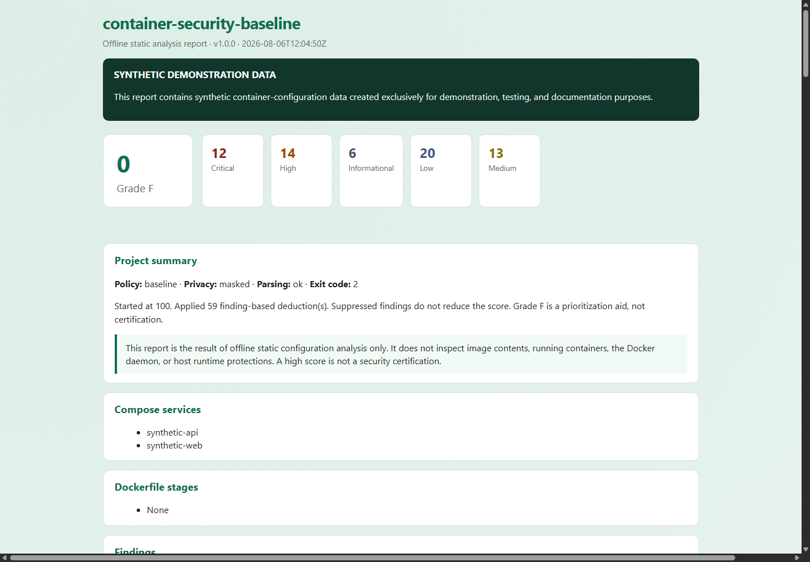

# container-security-baseline

[](https://github.com/salvomazzaglia/container-security-baseline/actions/workflows/ci.yml)


**Offline static-analysis toolkit for Docker Compose and Dockerfile security baselines — configuration review without Docker, without network, and without modifying inputs.**

> The screenshot, configuration examples, reports, and remediation patch contain synthetic demonstration data only. No real container, host, registry, credential, network, Portainer, or homelab information is included.

> This project performs offline static analysis only. It does not connect to Docker, inspect running containers, pull images, resolve image digests, or scan image vulnerabilities.

> A high score is not a security certification. Findings and remediations require review in the context of the application and deployment environment.



---

## Value proposition

**container-security-baseline** helps operators and reviewers assess the **configuration baseline** of Compose files and Dockerfiles before deployment. It flags potential exposure patterns — privileged mode, host namespaces, embedded secrets, weak identity, broad mounts, and related least-privilege gaps — and produces JSON, HTML, and SARIF reports with transparent scoring, governed suppressions, and recommended remediation that always requires human review.

It complements image scanners and runtime controls as one layer of **defense in depth**. It does not certify that a container is secure or that images are vulnerability-free.

---

## Problem being solved

Compose and Dockerfiles often encode high-impact security decisions: privilege, host access, networking, secrets, and image provenance. Those decisions are easy to miss in review and expensive to discover in production.

Teams need a repeatable, CI-friendly static check that:

- Works **offline** on explicit inputs
- Never invokes Docker or touches the daemon
- Redacts secret-like values in reports
- Explains findings with severity, risk, and recommended remediation
- Fails pipelines on policy thresholds without claiming compliance certification

---

## Static-analysis scope

| In scope | Out of scope |
|----------|--------------|
| Compose YAML/JSON and Dockerfile text | Running containers / daemon state |
| Declared privileges, mounts, networks, caps | Image vulnerability scanning (CVE) |
| Secret-like literals and high-entropy heuristics | Registry pulls / digest resolution |
| Policy profiles, scoring, suppressions | Host kernel / AppArmor / SELinux verification |
| Proposed unified diffs (Compose YAML only) | Automatic remediation applied to disk |

See [docs/standards-and-limitations.md](docs/standards-and-limitations.md).

---

## Safety guarantees

- **Never** invokes `docker`, `podman`, BuildKit, or the Docker socket
- **Never** makes network requests or pulls images
- **Never** resolves Compose interpolation or follows `include` / `extends`
- **Never** reads referenced `env_file`, secrets, or config file contents
- **Never** modifies analyzed input files; proposed patches are output-only
- **Never** stores or prints raw secret values — evidence is redacted
- Path resolution stays inside `--project-root`; symlink escapes are rejected

See [docs/input-safety.md](docs/input-safety.md) and [docs/secret-handling.md](docs/secret-handling.md).

---

## Main features

| Area | Capability |
|------|------------|
| **Scan** | Compose YAML/JSON + Dockerfile static analysis |
| **Rules** | 90+ Compose and 45+ Dockerfile rules (`config/rules.json`) |
| **Policies** | `baseline`, `strict`, `development` profiles |
| **Scoring** | Transparent 0–100 score with letter grades A–F |
| **Suppressions** | Justified, expiring, audited; Critical restricted by policy |
| **Reports** | JSON, standalone HTML, SARIF 2.1 subset |
| **Suggest** | Proposed unified diff — never auto-applied |
| **Compare** | Before/after findings and score delta |
| **CLI** | `scan`, `validate`, `list-rules`, `explain`, `suggest`, `compare`, `generate-demo`, `version` |
| **CI** | GitHub-hosted matrix; exit codes for gate decisions |

---

## Supported inputs

| Input | Notes |
|-------|--------|
| Compose YAML | `compose.yml`, `docker-compose.yml`, or explicit `--compose` |
| Compose JSON | Explicit `--compose-json` (canonical / pre-resolved model) |
| Dockerfile | Explicit `--dockerfile` or discovery names |
| Project root | Paths resolved safely under `--project-root` |

Discovery names are configurable in `config/default.config.json`.

---

## Compose trust model

Compose input must be **trusted for analysis** before you treat findings as actionable. The analyzer never executes Compose. Referenced files are not read; interpolation is not resolved; `include` and `extends` are not followed. Pre-resolved JSON may already contain sensitive content. Static analysis cannot reproduce every aspect of Compose evaluation — separately review the effective runtime configuration.

Full detail: [docs/compose-trust-model.md](docs/compose-trust-model.md).

---

## Compose checks

Compose rules cover privilege, host access, isolation, capabilities, identity, filesystem mounts, secrets, networking, resources, reliability, logging, image provenance, build security, and configuration trust.

Examples of Critical findings:

- `CSB-CMP-001` privileged mode
- `CSB-CMP-002` Docker/runtime socket mounted
- `CSB-CMP-003` host root bind-mounted
- `CSB-CMP-020` `cap_add: ALL`
- `CSB-CMP-024` seccomp unconfined
- `CSB-CMP-050` secret-like environment literals

Catalog: [docs/rule-catalog.md](docs/rule-catalog.md) · Analysis notes: [docs/compose-analysis.md](docs/compose-analysis.md).

---

## Dockerfile checks

Dockerfile rules cover image provenance, identity (`USER`), secrets in `ENV`/`ARG`/instructions, supply chain (`ADD` URLs, curl\|sh), package hygiene, filesystem permissions, process model (`CMD`/`ENTRYPOINT`/`HEALTHCHECK`), and build-context breadth.

Examples of Critical/High findings:

- `CSB-DF-020` / `CSB-DF-022` secret-like ENV or instruction literals
- `CSB-DF-023` COPY/ADD of sensitive credential files
- `CSB-DF-011` final `USER` is root
- `CSB-DF-032` curl/wget piped to shell

See [docs/dockerfile-analysis.md](docs/dockerfile-analysis.md).

---

## Policy profiles

| Profile | Role | Default `fail_on` | `minimum_score` |
|---------|------|-------------------|-----------------|
| **baseline** | Balanced production-oriented baseline | High | 0 |
| **strict** | Stronger least-privilege expectations | Medium | 70 |
| **development** | Keeps Critical/High isolation; relaxes selected conveniences | High | 0 |

Profiles live under `config/*.policy.json`. Details: [docs/policy-profiles.md](docs/policy-profiles.md).

---

## Scoring

- Start at **100** (configurable)
- Deduct per unique Fail/Warning finding by severity (Critical 25, High 15, Medium 7, Low 2, Informational 0 by default)
- Suppressed, Pass, N/A, and Unavailable findings do **not** deduct
- Grades: A ≥90, B ≥80, C ≥70, D ≥50, else F
- Partial analysis (parse/eval errors) is marked explicitly

The score is a **prioritization aid**, not certification. See [docs/scoring-model.md](docs/scoring-model.md).

---

## Suppressions

Suppressions require id, rule_id, target, justification, owner, UTC create/expiry, review reference, and enabled flag. Wildcard targets are rejected. Critical suppressions require policy permission (`allow_critical_suppressions`), stronger justification, and remain visible in reports for audit.

See [docs/suppressions.md](docs/suppressions.md) and `config/suppressions.example.json`.

---

## Secret redaction

Detection uses key-name heuristics, known token shapes, private-key headers, URL credentials, and optional high-entropy checks. Hits produce fingerprints and `[REDACTED]` evidence only — secret values are never stored in findings or reports. Referenced secret/env files are never opened.

See [docs/secret-handling.md](docs/secret-handling.md).

---

## Quick start

```bash
git clone https://github.com/salvomazzaglia/container-security-baseline.git
cd container-security-baseline

python -m venv .venv
# Windows: .venv\Scripts\activate
# Linux/macOS: source .venv/bin/activate

python -m pip install -U pip
python -m pip install -e ".[dev]"

container-security-baseline scan \
  --compose examples/compose/mixed-compose.yml \
  --policy baseline \
  --output-directory reports \
  --format all \
  --synthetic
```

Open `reports/report.html` or inspect `reports/report.json` / `reports/report.sarif`.

---

## Installation

**Requirements:** Python 3.11+, PyYAML, jsonschema.

```bash
python -m pip install -e .
python -m pip install -e ".[dev]"   # pytest, ruff, mypy, build
```

Entry points:

```bash
container-security-baseline --help
python -m container_security_baseline --help
```

---

## Scan examples

```bash
# Baseline policy on insecure synthetic Compose + Dockerfile
container-security-baseline scan \
  --compose examples/compose/insecure-compose.yml \
  --dockerfile examples/dockerfiles/Dockerfile.insecure \
  --policy baseline \
  --output-directory temp/baseline-report \
  --format all \
  --synthetic

# Strict policy (may exit 2 on intentional High/Critical findings)
container-security-baseline scan \
  --compose examples/compose/insecure-compose.yml \
  --dockerfile examples/dockerfiles/Dockerfile.insecure \
  --policy strict \
  --output-directory temp/strict-report \
  --format all \
  --synthetic
```

---

## Project-directory example

```bash
container-security-baseline scan \
  --project-root examples/project \
  --compose examples/project/compose.yml \
  --dockerfile examples/project/Dockerfile \
  --policy baseline \
  --output-directory temp/project-report \
  --format all \
  --synthetic
```

---

## Report formats

| Format | File | Purpose |
|--------|------|---------|
| JSON | `report.json` | Automation, schema-validated |
| HTML | `report.html` | Offline human review |
| SARIF | `report.sarif` | IDE / code-scanning import (local) |

Privacy modes: `masked` (default) and `full` (prints a console warning). See [docs/reports.md](docs/reports.md).

---

## SARIF

SARIF 2.1 subset output maps findings to results with redacted messages and rule metadata. Suitable for local tooling; CI does **not** upload to GitHub code scanning by default.

See [docs/sarif-integration.md](docs/sarif-integration.md).

---

## Suggested remediation

```bash
container-security-baseline suggest \
  --compose examples/compose/insecure-compose.yml \
  --policy baseline \
  --output temp/proposed-remediation.patch
```

Output is labeled **PROPOSED REMEDIATION ONLY — MANUAL REVIEW REQUIRED**. Patches are never applied to source files. See [docs/proposed-patches.md](docs/proposed-patches.md) and [docs/remediation-guidance.md](docs/remediation-guidance.md).

---

## Comparison

```bash
container-security-baseline compare \
  --before examples/compose/insecure-compose.yml \
  --after examples/compose/hardened-compose.yml \
  --policy baseline \
  --output-directory temp/comparison \
  --format all
```

Reports resolved, new, and unchanged findings plus score delta.

---

## Exit codes

| Code | Meaning |
|-----:|---------|
| **0** | Success / no policy failure |
| **1** | Findings present but below fail threshold (and score OK) |
| **2** | Policy failure (severity threshold, minimum score, or Critical suppression policy) |
| **3** | Error (invalid input, parse failure, unsafe path, internal error) |

See [docs/exit-codes.md](docs/exit-codes.md).

---

## Architecture

```mermaid
flowchart LR
  IN[Explicit project inputs] --> P[Safe YAML / JSON / Dockerfile parsers]
  P --> M[Normalized configuration model]
  M --> E[Policy and rule engine]
  E --> F[Secret-safe finding generation]
  F --> S[Scoring and suppressions]
  S --> R[Remediation guidance]
  R --> D[Optional proposed unified diff]
  D --> OUT[JSON / HTML / SARIF reports]
  OUT --> CI[Comparison and CI policy result]
```



Modules live under `src/container_security_baseline/`. See [docs/architecture.md](docs/architecture.md).

---

## Testing

Development tests use pytest with synthetic fixtures under `tests/fixtures/`. Run:

```bash
python -m ruff check src tests scripts
python -m ruff format --check src tests scripts
python -m mypy
python -m pytest
```

See [docs/testing.md](docs/testing.md).

---

## CI integration

GitHub Actions (`.github/workflows/ci.yml`) runs on GitHub-hosted `ubuntu-latest` / `windows-latest` with Python 3.11 and 3.12. Permissions are `contents: read`. No Docker, no secrets, no `pull_request_target`.

Guidance: [docs/ci-integration.md](docs/ci-integration.md).

---

## Security and privacy

Report vulnerabilities privately (see [SECURITY.md](SECURITY.md)). Do not open public issues with real Compose files, credentials, or host paths. Tracked examples are synthetic only.

Related docs: [docs/threat-model.md](docs/threat-model.md), [docs/security-audit-v1.0.0.md](docs/security-audit-v1.0.0.md).

---

## Known limitations

- No runtime or image-content inspection
- No CVE / vulnerability database
- No CIS/NIST certification claims
- Compose evaluation is incomplete by design (no interpolation resolve, no referenced-file reads)
- Heuristic secret detection produces potential exposure signals that require review
- Proposed patches cover a small set of safe Compose changes only

See [docs/standards-and-limitations.md](docs/standards-and-limitations.md) and [docs/false-positives.md](docs/false-positives.md).

---

## Roadmap

- Broader safe patch coverage with stronger YAML structural editing
- Optional operator-supplied effective-config import improvements
- Richer SARIF taxonomy and IDE snippets
- Additional policy packs for specialized workloads (still offline, still non-certifying)

---

## Skills demonstrated

Container security · Docker · Docker Compose · Dockerfile analysis · DevSecOps · Policy as code · Least privilege · Secure configuration review · Secret detection and redaction · YAML/JSON security · SARIF · Python · pytest · Ruff · mypy · GitHub Actions · Cross-platform CI · Threat modeling · Technical documentation

---

## Contributing

See [CONTRIBUTING.md](CONTRIBUTING.md). Use synthetic fixtures only; never commit real infrastructure or secrets; never require Docker in CI.

---

## License

MIT — see [LICENSE](LICENSE).

---

## Author

**Salvatore Mazzaglia** — [github.com/salvomazzaglia](https://github.com/salvomazzaglia)

Related portfolio projects: [sysadmin-health-check](https://github.com/salvomazzaglia/sysadmin-health-check), [backup-integrity-verifier](https://github.com/salvomazzaglia/backup-integrity-verifier), [network-device-watch](https://github.com/salvomazzaglia/network-device-watch), [self-hosted-runner-hardening-lab](https://github.com/salvomazzaglia/self-hosted-runner-hardening-lab), [endpoint-incident-triage](https://github.com/salvomazzaglia/endpoint-incident-triage).
