# Architecture

## Overview

`container-security-baseline` is an offline CLI that analyzes explicit Compose
and Dockerfile inputs and emits secret-safe structured reports.

```mermaid
flowchart LR
  IN[Explicit project inputs] --> P[Safe YAML / JSON / Dockerfile parsers]
  P --> M[Normalized configuration model]
  M --> E[Policy and rule engine]
  E --> F[Secret-safe finding generation]
  F --> S[Scoring and suppressions]
  S --> R[Remediation guidance]
  R --> D[Optional proposed unified diff]
  D --> OUT[JSON / HTML / SARIF reports]
  OUT --> CI[Comparison and CI policy result]
```

## Package layout

| Module | Responsibility |
|--------|----------------|
| `cli.py` | Argument parsing and command dispatch |
| `evaluator.py` / `scan.py` | Orchestrate load → rules → score → exit code |
| `compose_loader.py` / `compose_model.py` | Safe Compose load and normalized model |
| `dockerfile_parser.py` | Conservative Dockerfile parsing |
| `compose_rules.py` / `dockerfile_rules.py` | Rule evaluation |
| `rule_registry.py` | Load `config/rules.json` |
| `policy.py` / `config.py` | Policy and tool configuration |
| `secret_detection.py` / `redaction.py` | Detection and masking |
| `scoring.py` | Transparent score and grade |
| `suppressions.py` | Validation and application |
| `remediation.py` / `patching.py` | Guidance and proposed diffs |
| `comparison.py` | Before/after report comparison |
| `json_report.py` / `html_report.py` / `sarif_report.py` / `console.py` | Outputs |
| `paths.py` / `source.py` | Project-root safety and source loading |
| `exit_codes.py` / `severities.py` / `statuses.py` / `models.py` | Shared contracts |

## Data flow

1. Resolve inputs under `--project-root` (reject escapes / unsafe symlinks).
2. Parse with resource limits; reject unsafe YAML tags and excessive aliases.
3. Build normalized Compose/Dockerfile models (no interpolation resolve).
4. Evaluate enabled rules for the selected policy profile.
5. Detect secret-like values; redact evidence; fingerprint only.
6. Apply suppressions with audit entries.
7. Deduplicate findings; calculate score/grade; compute exit code.
8. Write requested report formats; optionally emit a proposed patch.

## Non-goals enforced in architecture

- No Docker SDK or subprocess to container engines
- No network I/O
- No in-place file mutation of analysis targets
- No reading of referenced secret/env/config file bodies
